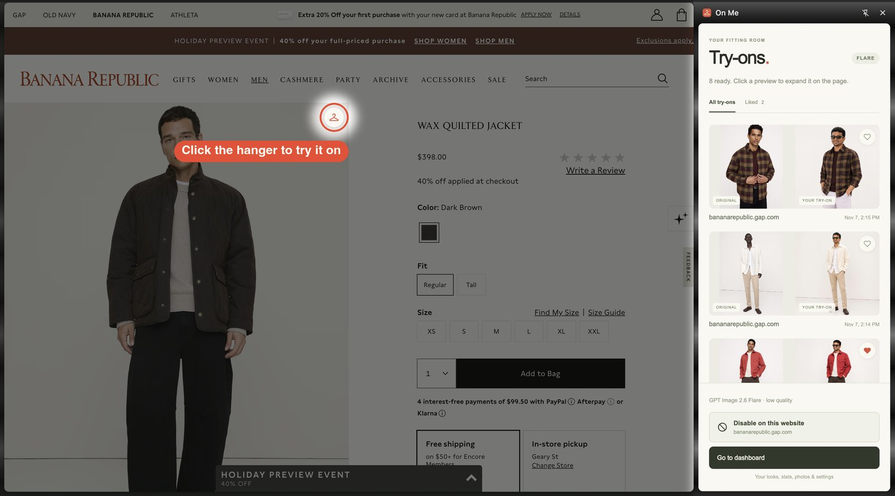
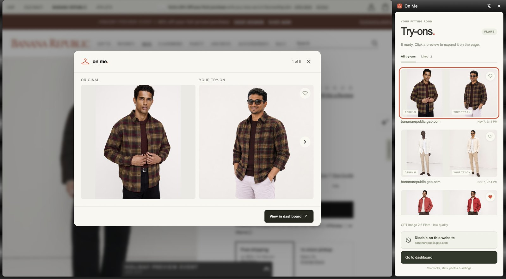
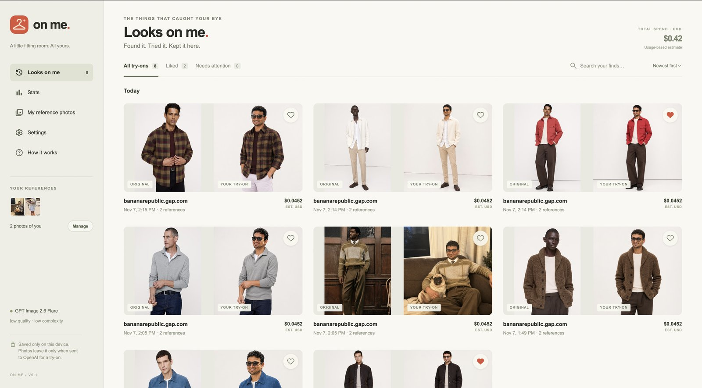
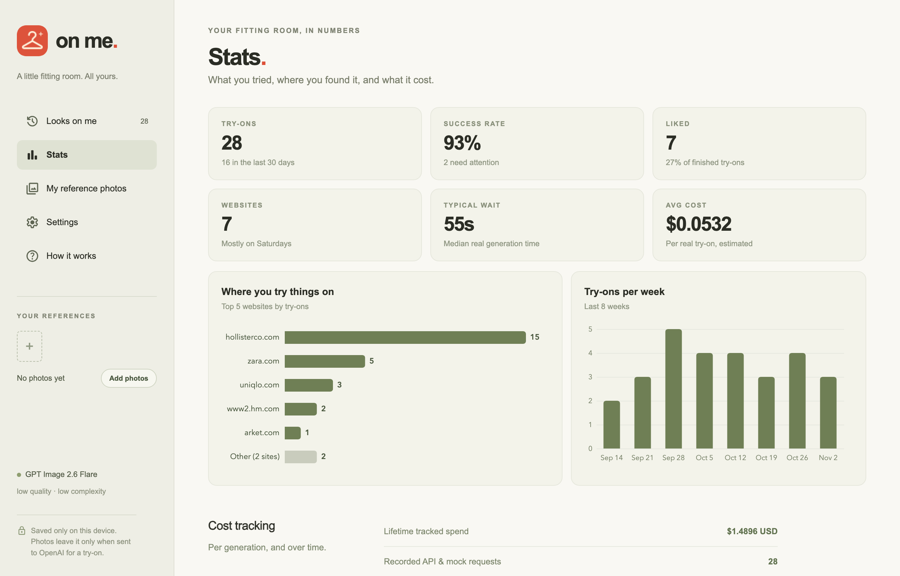

<h1 align="center">On Me</h1>

A Chrome extension for virtual try-ons, with a sidebar, saved comparisons, likes, and cost tracking.

  
  
  

## Setup

1. Open `chrome://extensions`, enable **Developer mode**, and **Load unpacked** → `extension/`.
2. Open the sidebar → **Go to dashboard**.
3. Add reference photos and save your OpenAI API key under **Settings**.
4. Refresh a shopping page and click the hanger on an image.

Defaults: **GPT Image 2.6 Flare**, low quality, low complexity. Mock mode is also available.

## Notes

- Click a finished sidebar preview for a larger comparison.
- **Skip this website** stops image buttons and scanning; manage the list in **Settings**. YouTube is skipped by default.
- Prompt: [`extension/prompts/try-on.txt`](extension/prompts/try-on.txt).
- History, references, and API key stay in your Chrome profile. Real try-ons send the selected image and references to OpenAI.
- Dashboard costs are usage-based estimates. Missing usage is marked unknown; requests are never automatically retried.
- Reload the extension and refresh shopping pages after code changes.
- This is a personal unpacked extension; use a backend for credentials before distributing it.

## Development

No build needed. `npm install && npm test` runs local tests. `npm run icons` regenerates the bundled icons.
